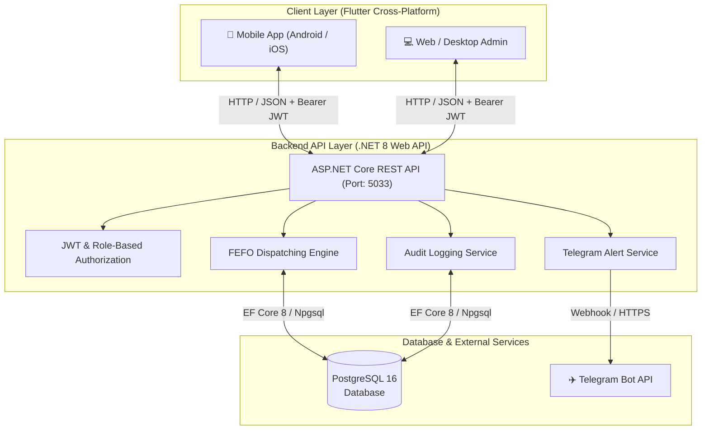

# 🍽️ Hệ Thống Quản Lý Kho Nhà Hàng (Restaurant Inventory Management System - Bếp Kho)

[](https://dotnet.microsoft.com/)
[](https://flutter.dev/)
[](https://www.postgresql.org/)
[](https://swagger.io/)
[](LICENSE)

> **Bếp Kho** là giải pháp phần mềm quản lý kho thông minh chuyên biệt cho chuỗi nhà hàng, khách sạn và dịch vụ ẩm thực (F&B). Hệ thống giải quyết triệt để bài toán kiểm soát nguyên vật liệu tươi sống, đồ khô và gia vị với hạn sử dụng khắt khe, tối ưu hóa quy trình xuất kho bằng thuật toán **FEFO (First Expired, First Out)**, tự động cảnh báo tồn kho qua **Telegram Bot**, và phân quyền kiểm duyệt chặt chẽ theo hạn mức ngân sách.

---

## 📑 Mục Lục
1. [Kiến Trúc Hệ Thống](#-kiến-trúc-hệ-thống)
2. [Tính Năng Nổi Bật](#-tính-năng-nổi-bật)
3. [Công Nghệ Sử Dụng (Tech Stack)](#-công-nghệ-sử-dụng-tech-stack)
4. [Cấu Trúc Thư Mục Dự Án](#-cấu-trúc-thư-mục-dự-án)
5. [Danh Sách Tài Khoản Thử Nghiệm (Seed Data)](#-danh-sách-tài-khoản-thử-nghiệm-seed-data)
6. [Hướng Dẫn Cài Đặt & Chạy Dự Án](#-hướng-dẫn-cài-đặt--chạy-dự-án)
   - [Cấu hình & Khởi chạy Backend (.NET 8)](#1-cấu-hình--khởi-chạy-backend-aspnet-core)
   - [Cấu hình & Khởi chạy Mobile App (Flutter)](#2-cấu-hình--khởi-chạy-mobile-app-flutter)
7. [Tổng Quan RESTful API Endpoints](#-tổng-quan-restful-api-endpoints)
8. [Cấu Hình Mạng & Kết Nối Thiết Bị](#-cấu-hình-mạng--kết-nối-thiết-bị)
9. [Xử Lý Sự Cố Thường Gặp (Troubleshooting)](#-xử-lý-sự-cố-thường-gặp-troubleshooting)

---

## 🏛️ Kiến Trúc Hệ Thống

Hệ thống được phát triển theo mô hình **Client - Server (RESTful API)** tách biệt:



### Quy Trình Nghiệp Vụ Cốt Lõi:
1. **Lập đơn mua hàng (PO):** Nhân viên tạo đơn hàng đề xuất nguyên vật liệu từ nhà cung cấp.
2. **Phê duyệt theo hạn mức (RBAC):** Bếp trưởng / Quản lý / Kế toán phê duyệt đơn mua dựa trên hạn mức ngân sách được cấu hình.
3. **Nhập kho theo PO:** Nhân viên kho đối soát thực tế, quét mã/lô hàng, nhập hạn sử dụng (EXP) và cập nhật số lượng tồn tức thời.
4. **Xuất kho theo thuật toán FEFO:** Hệ thống tự động truy vấn và phân bổ các lô hàng có **hạn sử dụng gần nhất xuất trước**, loại bỏ tình trạng thất thoát do hàng quá date.
5. **Kiểm kê & Cân bằng kho:** Kiểm đếm định kỳ, ghi nhận chênh lệch và tự động sinh phiếu điều chỉnh sau khi Quản lý duyệt.

---

## ✨ Tính Năng Nổi Bật

### 1. Phân Quyền Vai Trò & Hạn Mức Duyệt (RBAC)
* Xác thực chuẩn **JSON Web Token (JWT Bearer)** kết hợp mã hóa mật khẩu an toàn bằng **BCrypt**.
* 5 cấp bậc phân quyền với hạn mức xét duyệt linh hoạt:
  * 👑 **Admin:** Toàn quyền hệ thống, không giới hạn hạn mức duyệt.
  * 👔 **Quản lý:** Duyệt đơn mua hàng & kiểm kê lên đến **50.000.000 VNĐ**.
  * 🍳 **Bếp trưởng:** Đề xuất và duyệt nguyên vật liệu tươi sống đến **10.000.000 VNĐ**.
  * 📦 **Nhân viên kho:** Thực hiện nghiệp vụ nhập, xuất kho, kiểm kê thực tế.
  * 💰 **Kế toán:** Đối soát thanh toán, duyệt đơn hàng đến **20.000.000 VNĐ**.

### 2. Thuật Toán Xuất Kho Thông Minh (FEFO - First Expired, First Out)
* Tự động quét các lô hàng (`LoHang`) trong kho và sắp xếp theo `NgayHetHan ASC`.
* Thuật toán tự động tách và trừ dần số lượng qua từng lô hàng cho đến khi đủ số lượng yêu cầu xuất, đảm bảo chất lượng nguyên liệu chế biến món ăn luôn tươi ngon nhất.

### 3. Quản Lý Đa Kho & Theo Dõi Tồn Kho Tức Thời
* Hỗ trợ phân loại khu vực kho: **Kho mát**, **Kho đông**, **Kho đồ khô**.
* Giám sát số lượng tồn khả dụng, định mức tồn an toàn tối thiểu (`TonToiThieu`).
* Hiển thị trực quan theo thanh đo sức khỏe kho hàng (Inventory Health Bar).

### 4. Cảnh Báo Tự Động Qua Telegram Bot
* Tự động bắn thông báo tức thời tới nhóm Telegram quản lý khi:
  * Tồn kho của bất kỳ nguyên liệu nào giảm xuống dưới ngưỡng tồn an toàn.
  * Có đơn hàng PO giá trị lớn cần người có thẩm quyền phê duyệt.

### 5. Kiểm Kê & Tự Động Cân Bằng Kho
* Hỗ trợ tạo đợt kiểm kê theo từng kho riêng biệt.
* Tính toán tự động số lượng lệch (Thừa / Thiếu) giữa hệ thống và thực tế.
* Sau khi Quản lý phê duyệt, hệ thống tự động sinh giao dịch điều chỉnh để số dư tồn kho khớp hoàn toàn với thực tế.

### 6. Giao Diện Cute Culinary Enterprise UI (Responsive)
* Tông màu ấm áp phong cách ẩm thực: **Caramel**, **Chocolate**, **Cream**.
* Thiết kế thích ứng đa thiết bị (Adaptive Layout): Tự động đổi giữa **Bottom Navigation Bar** trên điện thoại và **Sidebar Menu** trên Tablet / Desktop Web.
* Tích hợp biểu đồ thống kê trực quan tuần, thẻ KPIs tổng quan giá trị tài sản kho.

---

## 🛠️ Công Nghệ Sử Dụng (Tech Stack)

### Backend (.NET 8 Web API)
* **Ngôn ngữ & Framework:** C# 12, ASP.NET Core 8.0 Web API
* **ORM:** Entity Framework Core 8.0 (Code-First & Migration)
* **Hệ quản trị CSDL:** PostgreSQL 16 (Npgsql.EntityFrameworkCore.PostgreSQL)
* **Bảo mật:** `Microsoft.AspNetCore.Authentication.JwtBearer`, `BCrypt.Net-Next`
* **Tài liệu API:** Swagger / OpenAPI 3.0 (Swashbuckle)
* **Third-Party:** Telegram Bot API (HttpClient)

### Frontend (Flutter Mobile / Web)
* **Ngôn ngữ & Framework:** Dart 3.x, Flutter 3.x (Material Design 3)
* **Quản lý trạng thái:** `provider` (MultiProvider, ChangeNotifier)
* **Lưu trữ dữ liệu cục bộ:** `shared_preferences` (Lưu JWT Token, phiên đăng nhập)
* **Giao tiếp mạng:** `http` Client với interceptor Bearer Token
* **UI & Typography:** `google_fonts` (Inter font), Custom Painter & Canvas Badge

---

## 📂 Cấu Trúc Thư Mục Dự Án

```text
He_thongh_quan_ly_kho/
├── RestaurantInventory.API/        # BACKEND ASP.NET CORE 8
│   ├── Controllers/               # Các RESTful API Controller
│   │   ├── AuthController.cs          # Xác thực đăng nhập, thông tin user
│   │   ├── HangHoaController.cs       # Danh mục hàng hóa, tổng hợp tồn kho
│   │   ├── DonMuaHangController.cs    # Đơn mua hàng PO & quy trình duyệt
│   │   ├── GiaoDichKhoController.cs   # Nhập kho PO, Xuất kho FEFO
│   │   ├── KiemKeController.cs        # Kiểm kê kho & cân bằng kho
│   │   └── AuditLogController.cs      # Truy vấn nhật ký hành động hệ thống
│   ├── Data/                      # Entity Framework Core DbContext & Seeding
│   │   ├── AppDbContext.cs            # Khai báo cấu trúc bảng CSDL
│   │   └── DbInitializer.cs           # Tự động khởi tạo DB và dữ liệu mẫu
│   ├── DTOs/                      # Data Transfer Objects (Request/Response)
│   ├── Models/                    # Thực thể CSDL (Entities)
│   ├── Services/                  # Business Logic Services
│   │   ├── InventoryService.cs        # Xử lý FEFO, Nhập PO, Kiểm kê
│   │   ├── AuthService.cs             # Tạo JWT, kiểm tra mật khẩu BCrypt
│   │   ├── TelegramService.cs         # Gửi thông báo Telegram Bot
│   │   └── AuditLogService.cs         # Ghi vết lịch sử thao tác
│   ├── appsettings.json           # Cấu hình Chuỗi kết nối DB, JWT, Telegram
│   └── Program.cs                 # Cấu hình Middleware, DI container, Pipeline
│
├── mobile_app/                     # FRONTEND FLUTTER APPLICATION
│   ├── lib/
│   │   ├── core/                  # Cấu hình API endpoints & hằng số mạng
│   │   ├── models/                # Models DTO giao tiếp API
│   │   ├── providers/             # Quản lý State toàn cục (AuthProvider)
│   │   ├── screens/               # Các màn hình chính
│   │   │   ├── login_screen.dart          # Màn hình đăng nhập
│   │   │   ├── dashboard_screen.dart      # Tổng quan Dashboard & Thống kê
│   │   │   ├── inventory_screen.dart      # Danh sách tồn kho tức thời
│   │   │   ├── transactions_screen.dart   # Lịch sử giao dịch nhập / xuất
│   │   │   ├── purchasing_screen.dart     # Quản lý đơn mua hàng (PO)
│   │   │   └── approvals_screen.dart      # Phê duyệt đơn mua & kiểm kê
│   │   ├── theme/                 # Bảng màu (AppColors) & Typography
│   │   ├── widgets/               # Các Dialog nghiệp vụ (FEFO, PO, Kiểm kê,...)
│   │   └── main.dart              # Entrypoint ứng dụng Flutter
│   └── pubspec.yaml               # Thư viện phụ thuộc Flutter
│
└── README.md                       # Tài liệu hướng dẫn dự án
```

---

## 👥 Danh Sách Tài Khoản Thử Nghiệm (Seed Data)

Khi khởi động Backend lần đầu, hệ thống sẽ tự động khởi tạo cơ sở dữ liệu và nạp sẵn 5 tài khoản mẫu cho 5 vị trí:

| Tên Đăng Nhập | Mật Khẩu | Họ Và Tên | Vị Trí / Vai Trò | Hạn Mức Duyệt |
| :--- | :---: | :--- | :--- | :---: |
| `admin_duy` | `123456` | Cao Thị Thu Uyên | **Admin** | Không giới hạn |
| `quanly_lan` | `123456` | Phan Ngọc Quỳnh Hương | **Quản lý** | 50.000.000 ₫ |
| `beptruong_hung` | `123456` | Nguyễn Thành Trung | **Bếp trưởng** | 10.000.000 ₫ |
| `nvkho_tuan` | `123456` | Nguyễn Trường Duy | **Nhân viên kho** | 0 ₫ |
| `ketoan_an` | `123456` | Lê Hoàng An | **Kế toán** | 20.000.000 ₫ |

---

## 🚀 Hướng Dẫn Cài Đặt & Chạy Dự Án

### Yêu Cầu Môi Trường
* **.NET SDK:** Phiên bản `8.0` trở lên.
* **Flutter SDK:** Phiên bản `3.19.x` hoặc mới hơn.
* **Cơ sở dữ liệu:** PostgreSQL 14+ (đang chạy cổng mặc định `5432`).
* **Công cụ chạy:** Visual Studio 2022 / VS Code / Android Studio.

---

### 1. Cấu hình & Khởi chạy Backend (ASP.NET Core)

#### Bước 1.1: Cấu hình Cơ sở dữ liệu
Mở file [appsettings.json](file:///d:/MyProject/He_thong_quan_ly_kho/He_thongh_quan_ly_kho/RestaurantInventory.API/appsettings.json) và điều chỉnh chuỗi kết nối PostgreSQL phù hợp với máy của bạn:

```json
"ConnectionStrings": {
  "DefaultConnection": "Host=localhost;Database=RestaurantInventory;Username=postgres;Password=your_password"
}
```

*(Tùy chọn)* Nếu muốn nhận thông báo qua Telegram, hãy điền `BotToken` và `ChatId`:
```json
"TelegramBot": {
  "BotToken": "YOUR_TELEGRAM_BOT_TOKEN",
  "ChatId": "YOUR_TELEGRAM_CHAT_ID"
}
```

#### Bước 1.2: Chạy Backend
Mở Terminal tại thư mục `RestaurantInventory.API`:
```bash
cd RestaurantInventory.API
dotnet restore
dotnet run --launch-profile http
```

* API sẽ lắng nghe tại: `http://localhost:5033`
* Truy cập giao diện tài liệu Swagger: **`http://localhost:5033/swagger`**
* *(Cơ sở dữ liệu và dữ liệu mẫu sẽ được tự động tạo ngay lần đầu khởi chạy thông qua `DbInitializer`)*.

---

### 2. Cấu hình & Khởi chạy Mobile App (Flutter)

#### Bước 2.1: Cài đặt gói thư viện
Mở Terminal tại thư mục `mobile_app`:
```bash
cd mobile_app
flutter pub get
```

#### Bước 2.2: Chạy ứng dụng

* **Chạy trên Web (Chrome):**
  ```bash
  flutter run -d chrome
  ```
* **Chạy trên Máy ảo Android (Android Emulator):**
  ```bash
  flutter run -d emulator-5554
  ```
* **Chạy trên Thiết bị thật (kết nối qua USB):**
  ```bash
  flutter run -d <device_id>
  ```

---

## 🌐 Cấu Hình Mạng & Kết Nối Thiết Bị

File cấu hình mạng [api_constants.dart](file:///d:/MyProject/He_thong_quan_ly_kho/He_thongh_quan_ly_kho/mobile_app/lib/core/api_constants.dart) đã được thiết kế tự động nhận diện thiết bị:

| Thiết Bị Chạy Flutter | Địa Chỉ Backend Tương Ứng | Ghi Chú |
| :--- | :--- | :--- |
| **Web Browser (Chrome)** | `http://localhost:5033/api` | Tự động qua biến `kIsWeb` |
| **Android Emulator** | `http://10.0.2.2:5033/api` | Tự động ánh xạ về localhost của máy tính |
| **Điện thoại thật (Android/iOS)** | `http://192.168.x.x:5033/api` | Nhập địa chỉ IPv4 máy tính cùng mạng Wifi |

---

## 📡 Tổng Quan RESTful API Endpoints

Tất cả các endpoint được bảo vệ bởi JWT Token (yêu cầu gửi kèm header `Authorization: Bearer <token>`), ngoại trừ endpoint đăng nhập:

### 🔐 1. Xác thực & Tài khoản (`/api/Auth`)
* `POST /api/Auth/login` - Đăng nhập bằng tên đăng nhập & mật khẩu, trả về thông tin user và JWT token.
* `GET /api/Auth/me` - Lấy thông tin chi tiết và quyền hạn của người dùng đang đăng nhập.

### 📦 2. Hàng hóa & Tồn kho (`/api/HangHoa`)
* `GET /api/HangHoa` - Lấy danh sách toàn bộ hàng hóa kèm đơn vị tính, danh mục, ngưỡng tồn an toàn.
* `GET /api/HangHoa/tonkho` - Lấy báo cáo tồn kho tức thời tổng hợp từ các kho và các lô hàng.
* `POST /api/HangHoa` - Tạo mới mã nguyên vật liệu/hàng hóa.

### 📝 3. Đơn mua hàng PO (`/api/DonMuaHang`)
* `GET /api/DonMuaHang` - Lấy danh sách toàn bộ đơn mua hàng PO.
* `POST /api/DonMuaHang` - Lập đơn mua hàng mới kèm chi tiết các mặt hàng.
* `POST /api/DonMuaHang/{id}/approve` - Phê duyệt đơn mua hàng (kiểm tra hạn mức quyền hạn).

### 🔄 4. Giao dịch Kho & FEFO (`/api/GiaoDichKho`)
* `POST /api/GiaoDichKho/nhap-po` - Nhập hàng vào kho theo mã PO đã được phê duyệt.
* `POST /api/GiaoDichKho/xuat-fefo` - Xuất kho nguyên vật liệu theo thuật toán **FEFO (Hạn dùng gần nhất xuất trước)**.

### 📊 5. Kiểm kê kho (`/api/KiemKe`)
* `GET /api/KiemKe` - Lấy danh sách các phiếu kiểm kê kho.
* `POST /api/KiemKe` - Tạo phiếu kiểm kê thực tế theo kho.
* `POST /api/KiemKe/{id}/approve` - Phê duyệt và tự động cân bằng số lượng tồn kho theo số liệu thực tế.

### 📜 6. Nhật ký hệ thống (`/api/AuditLog`)
* `GET /api/AuditLog` - Xem nhật ký thao tác người dùng (Ai, Làm gì, Thời gian nào, Bảng dữ liệu nào).

---

## 🛠️ Xử Lý Sự Cố Thường Gặp (Troubleshooting)

### 1. Lỗi Gradle trên Windows: `this and base files have different roots`
* **Nguyên nhân:** Xảy ra khi thư mục mã nguồn project nằm ở ổ đĩa khác với ổ chứa thư mục Pub Cache của Flutter (ví dụ Project ở `D:\`, Pub Cache ở `C:\Users\...`).
* **Cách khắc phục:** File `mobile_app/android/gradle.properties` đã được cấu hình sẵn:
  ```properties
  kotlin.incremental=false
  kotlin.incremental.useClasspathSnapshot=false
  ```
  Nếu gặp lại lỗi, chạy lệnh sau để dọn dẹp cache:
  ```bash
  cd mobile_app
  flutter clean
  flutter pub get
  ```

### 2. Thiết bị Android không kết nối được Backend
* Đảm bảo Backend ASP.NET Core đang chạy (`http://localhost:5033`).
* Nếu dùng **Máy ảo Android**: Đảm bảo dùng IP `10.0.2.2:5033` (đã được cấu hình tự động).
* Nếu dùng **Điện thoại thật**: Đảm bảo điện thoại và máy tính cùng kết nối chung một mạng Wifi, và cấu hình tường lửa (Windows Firewall) cho phép cổng `5033`.

### 3. Lỗi kết nối cơ sở dữ liệu PostgreSQL
* Đảm bảo dịch vụ PostgreSQL đang chạy (`services.msc` -> tìm `postgresql-x64-...`).
* Kiểm tra `Username` và `Password` trong file `appsettings.json`.

---

## 📄 Bản Quyền & Tác Giả

* **Đơn vị phát triển:** Dự án Hệ Thống Quản Lý Kho Nhà Hàng - Bếp Kho
* **Nhóm tác giả:** Cao Thị Thu Uyên & Cộng sự
* **Giấy phép:** Được phát hành theo giấy phép [MIT License](LICENSE).

